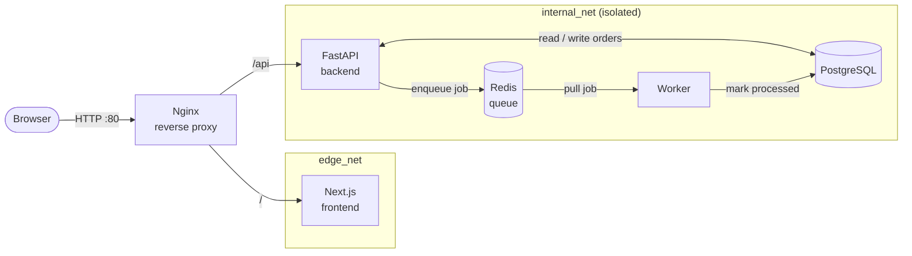
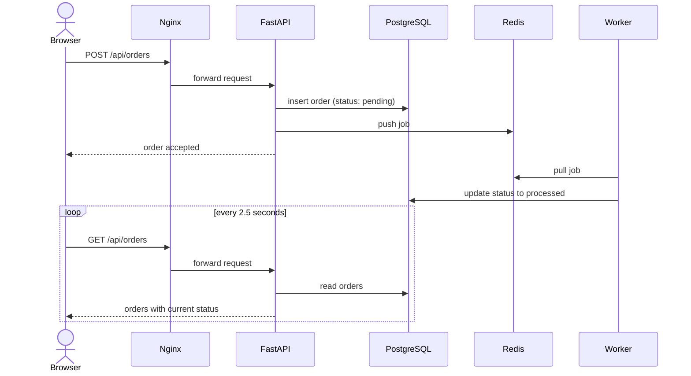

# Docker Orderline

Docker Orderline is a small multi-container system that accepts orders through a web UI and processes them asynchronously in the background. It is built to show how a typical Docker Compose stack fits together: a reverse proxy, a web frontend, an API, a message queue, a background worker and a database, each in its own container, with network isolation between them.

Submit an order, and watch its status change from **Processing** to **Processed** in the UI while a worker handles it behind the scenes.

## What this project demonstrates

- Orchestrating six services with Docker Compose, each in its own container.
- Network isolation with a public-facing network and an internal-only network.
- Dependency-aware startup using health checks.
- Persistent storage with a named volume.
- A single entry point: Nginx as the reverse proxy.
- Keeping slow work out of the request cycle with a queue and a background worker.

## Architecture



Nginx is the only container that publishes a port to the host. It also sits on both Docker networks, which makes it the single bridge between the outside world and the private services.

### Services

| Service | Image / build | Role | Networks |
| --- | --- | --- | --- |
| `nginx` | `nginx:1.27-alpine` | Entry point on port 80. Serves the UI and forwards API calls to the backend. | `edge_net`, `internal_net` |
| `frontend` | `./frontend` (Next.js) | The web UI. Calls the API through the relative path `/api`. | `edge_net` |
| `backend` | `./backend` (FastAPI) | REST API. Stores orders and pushes processing jobs to the queue. | `internal_net` |
| `worker` | `./worker` | Takes jobs from the queue, processes them and updates the order status. | `internal_net` |
| `redis` | `redis:7-alpine` | Job queue between the API and the worker. | `internal_net` |
| `db` | `postgres:16-alpine` | Persistent storage for orders. | `internal_net` |

## How a request flows



1. The user submits the form. The browser sends `POST /api/orders` to Nginx.
2. Nginx routes `/api` traffic to the FastAPI backend.
3. The backend saves the order in PostgreSQL as pending and publishes a job to Redis, then responds right away. The user never waits for the actual processing.
4. The worker, running as a separate container, picks the job from Redis, does the work and marks the order as processed in PostgreSQL.
5. The frontend polls `GET /api/orders` every 2.5 seconds, so the status change appears in the UI without a page refresh.

Splitting the API from the worker is the main idea of the project: slow work happens outside the request cycle, and the API stays fast regardless of how long processing takes.

## Docker design

### Network isolation

Two bridge networks separate public-facing and private traffic:

- **`edge_net`** connects Nginx and the frontend.
- **`internal_net`** is declared with `internal: true`, so containers on it have no route to the outside world. It holds the backend, worker, Redis and PostgreSQL.

What this gives you:

- The database and Redis are not reachable from the host or the internet, and they have no published ports.
- The frontend container is not on the same network as the database, so it cannot talk to it even if compromised.
- Only Nginx can reach both sides, which keeps the exposed surface to a single port.

### Startup order and health checks

Containers start in dependency order, and `depends_on` waits for health, not just for a container to exist:

1. `db` and `redis` start first and report healthy through `pg_isready` and `redis-cli ping`.
2. `backend` and `worker` start once both are healthy. The backend exposes `/health`, which Docker polls.
3. `frontend` waits for a healthy backend.
4. `nginx` starts last, after the frontend is up and the backend is healthy.

This avoids the usual race where the API starts before its database is ready. All services use `restart: unless-stopped`.

### Persistence

- PostgreSQL data lives in the named volume `pgdata`, so orders survive container restarts and rebuilds.
- Redis has no volume. Queued jobs that have not been picked up yet are lost if the Redis container is removed. That is acceptable for a demo, but see the ideas below.

## Getting started

### Prerequisites

- Docker with Docker Compose v2

### Run it

```bash
git clone https://github.com/<your-username>/docker-orderline.git
cd docker-orderline

cp .env.example .env      # then edit the values
docker compose up -d --build
```

Wait a few seconds for the health checks to pass, then open **http://localhost**.

### Configuration

The stack is configured through a `.env` file in the project root. Never commit it. The PostgreSQL container reads these variables:

| Variable | Purpose |
| --- | --- |
| `POSTGRES_USER` | Database user |
| `POSTGRES_PASSWORD` | Database password |
| `POSTGRES_DB` | Database name |

The backend and worker also load `.env`, so see `.env.example` for the full list.

### Useful commands

```bash
docker compose ps                  # service status and health
docker compose logs -f worker      # follow one service's logs
docker compose up -d --build frontend   # rebuild a single service
docker compose down                # stop and remove containers, keep data
docker compose down -v             # also delete volumes (wipes the database)
```

## Project structure

```
.
├── docker-compose.yml
├── .env.example
├── nginx/
│   └── default.conf      # routing rules
├── frontend/             # Next.js app
├── backend/              # FastAPI service
└── worker/               # background job processor
```

## Ideas for improvement

- Add a volume or append-only persistence to Redis so queued jobs survive restarts.
- Run several workers to process jobs in parallel. The worker service currently sets a fixed `container_name`, which has to be removed before `docker compose up --scale worker=3` can work.
- Add retries and a dead-letter queue for failed jobs.
- Terminate HTTPS at Nginx.
- Replace polling with Server-Sent Events or WebSockets.

## Tech stack

Docker Compose · Nginx · Next.js · Tailwind CSS · FastAPI · Redis · PostgreSQL